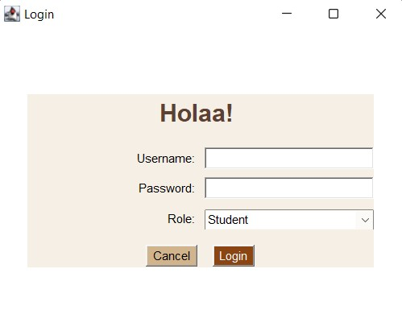
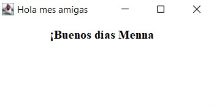
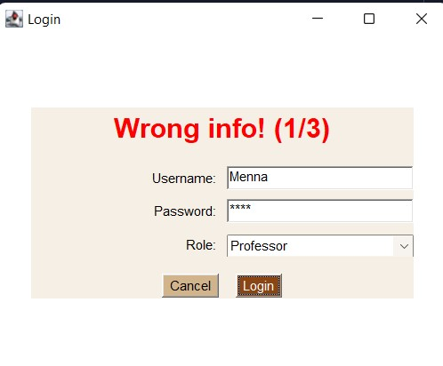
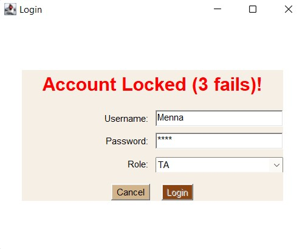

# ☕ Holaa! | Java Login Form

A cozy little login window built with **Java AWT**, with warm coffee-colored tones, a handwritten-style title, and a Spanish welcome once you're in.

> Built as a programming task, but with a bit of personality.

---

## 📸 Preview






---

## 🔐 How the login works

You enter a **username**, a **password**, and pick your **role** from a dropdown. All three must match a registered user, otherwise the title above the form turns red and tells you what went wrong:

| What happens | What you see |
|---|---|
| Empty field | `Please fill all fields!` |
| Wrong username / password / role | `Wrong info! (1/3)`, then `(2/3)` |
| Third failed attempt | `Account Locked (3 fails)!` and the Login button is disabled |
| Correct info | The login window closes and a welcome window opens: **¡Buenos días, username** |

The **Cancel** button simply closes the window.

---

## 👥 Try it yourself

| Username | Password | Role |
|---|---|---|
| Menna | 2204 | Student |
| Shrouk | 2908 | DS |
| Hania | 1234 | TA |

*(Sample data only, hard-coded in `loadUsers()`.)*

---

## 🧱 Under the hood

- `User`: a small class holding username, password and role
- `WelcomePage`: the greeting window shown after a successful login
- `LoginFormTask`: the main login window, built with `Frame`, `Panel`, `TextField`, `Choice` and `Button`, laid out using `GridBagLayout`, `BorderLayout`, `GridLayout` and `FlowLayout`
- Users are stored in an `ArrayList` and searched by username
- Events handled with lambda `ActionListener`s and `WindowAdapter`

---

## ▶️ Run it

1. Clone the repo

```
   git clone https://github.com/mennajr10/LoginFormJava.git
```

2. Open it in IntelliJ IDEA
3. Run `LoginFormTask.java`

---

Made by **Menna Muhammed** 🤍
